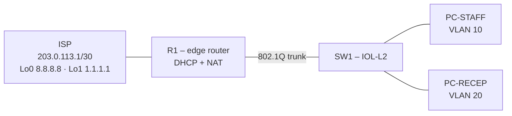

# Ahuriri Physio – Troubleshooting Lab

A small-business outage scenario built with [containerlab](https://containerlab.dev) and Cisco IOL.
Level: **junior support** · Topics: 802.1Q trunking, DHCP, static routing, NAT/PAT

## The ticket

> On Friday a contractor set up a separate network for the new reception desk.
> Since then the physios can't open any websites (their PCs show "connected"),
> and the new reception PC never gets an IP address.

**Goal:** restore internet access for both the staff and reception networks.

## Topology



| VLAN | Name      | Subnet          | Gateway       |
| ---- | --------- | --------------- | ------------- |
| 10   | STAFF     | 192.168.10.0/24 | 192.168.10.1  |
| 20   | RECEPTION | 192.168.20.0/24 | 192.168.20.1  |
| –    | WAN       | 203.0.113.0/30  | ISP .1, R1 .2 |

## Requirements

- containerlab
- Cisco IOL images (`vrnetlab/cisco_iol:17.18.02` and `vrnetlab/cisco_iol:L2-17.18.02`) – not included, you need your own licensed images
- `ghcr.io/hellt/network-multntool`

## Run it

```bash
sudo containerlab deploy -t ahuriri_physio.clab.yml
# wait ~2 minutes for IOL to boot
docker exec -it clab-ahuriri-physio-PC-STAFF sh
udhcpc -i eth1
ping 8.8.8.8
```

Routers and switch: `ssh admin@clab-ahuriri-physio-R1` (password `admin`).

Clean up (also clears saved NVRAM configs):

```bash
sudo containerlab destroy -t ahuriri_physio.clab.yml --cleanup
```

## Spoilers

My troubleshooting write-up is in [SOLUTION.md](SOLUTION.md). Try the lab first!

---

_Lab scenario designed with an AI tutor as part of my Network+ / CCNA study. The troubleshooting and the write-up are my own._
